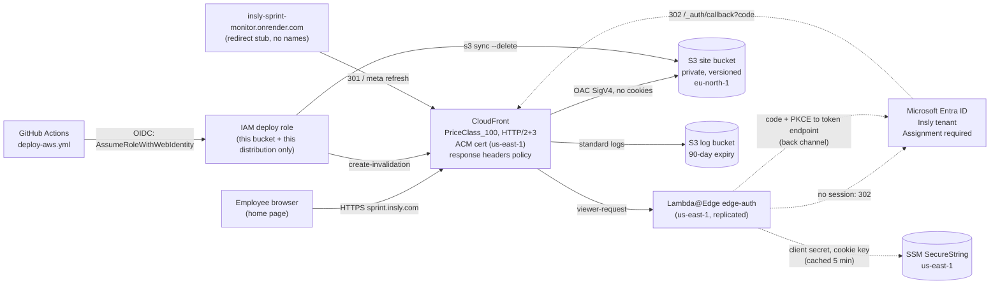

# MGA Sprint Board: Render to AWS, employee-only

Status: **proposal, nothing applied** (2026-10-02). Owner direction of 2026-10-02: move the page off
onrender.com for privacy. Skeleton: [infra/aws/](../../infra/aws/README.md), workflow:
[.github/workflows/deploy-aws.yml](../../.github/workflows/deploy-aws.yml) (manual only, inert until the infra exists).

**In one paragraph:** serve `public/` from a private S3 bucket through CloudFront. A small Lambda@Edge
function signs people in with Microsoft Entra ID before any file is served. On Intune-managed laptops
that sign-in is a silent redirect, so the browser home page still opens with no prompt. It costs about
1 USD a month, has no servers, and is defined in OpenTofu. Deploys come from GitHub Actions over OIDC,
with no stored keys. Rollback is a redeploy of an older SHA. Once Render only serves a redirect stub,
the repo goes private.

---

## 1. Context

| Today | Problem |
|---|---|
| Public static site at `https://insly-sprint-monitor.onrender.com` | Anyone on the internet sees an internal process and the dev deploy rota (first name + last initial). |
| Built from the **public** repo `Insly/sprint-monitor` | It is public only because Render's GitHub app cannot see Insly org repos. The history also holds the names. |
| Deploys: GitHub Actions runs tests, then POSTs a Render deploy hook | Works. The hook URL is a long-lived secret. |
| People have set the URL as their browser home page; README documents an Intune policy | The URL has to keep working through the move. |

Goals (owner):
1. Only Insly employees can open the page.
2. The repo can go private again.
3. It stays a static site: cheap, low-maintenance, playbook tier T1 (one owner, managed services, OpenTofu, one-command rollback, no Kubernetes).
4. The home-page URL keeps working: a friendly hostname, plus a redirect from the Render URL during the transition.

Constraints: Entra ID is Insly's identity provider. EU data (eu-north-1 or eu-central-1). T1 "Do NOT" list:
no multi-region, no WAF as a substitute for authorization, no Kubernetes.

## 2. Options for employee-only access, compared

Assumptions for the numbers: about 150 staff, 2 page loads per working day each, 6 files per load,
so about 40k requests a month. Prices are approximate public list prices for 2026; check them before
deciding. For each option, "Login feel" describes what a person sees when the page is their browser home page.

| | (a) S3 + CloudFront (OAC) + **Lambda@Edge OIDC** to Entra | (b) CloudFront + **ALB OIDC** to Entra, then S3 via Lambda or a tiny container | (c) **Amplify Hosting** with password protection | (d) CloudFront + **WAF IP allow-list** | (e) **Cognito** federated with Entra, in front of CloudFront |
|---|---|---|---|---|---|
| **Monthly cost** | ~0.1 to 1 USD (CloudFront free tier; Lambda@Edge and S3 cost cents) | ~25 to 30 USD (ALB hours + LCU ~22, 2 public IPv4 ~7, target cents) | ~0 to 1 USD | ~6 to 7 USD (web ACL 5 + rule 1 + requests) | ~1 to 3 USD (50 federated MAU free, then ~0.015 USD/MAU, plus Lambda@Edge) |
| **Setup effort** | 2 to 3 days (infra + ~250 lines of auth code + IT coordination) | 2 to 3 days (VPC, ALB, listener rules, target, CloudFront in front) | ½ day, **but** Amplify's GitHub app has the same org-approval problem as Render (or manual zip deploys) | 1 day, plus a VPN dependency for every user | 3 to 4 days (user pool, domain, Entra IdP, app client, AWS sample stack of several edge functions, deployed with SAM rather than OpenTofu) |
| **Maintenance** | Lambda Node runtime bump about every 2 years; Entra client secret rotation (at most 24 months); our code is ours to fix | ALB and VPC are AWS-managed; a container target needs patching (a Lambda target does not); secret rotation | Change and redistribute the password whenever someone leaves | Keep the IP list in sync with offices and VPN egress | Two identity systems to understand; the sample stack must be upgraded by redeploying it; secret rotation |
| **Login feel** | Session cookie we choose (default 12 h). On managed laptops renewal is a silent redirect to Entra and back (~1 s flash). Elsewhere it is the normal Microsoft login, with Entra's "stay signed in". | Same silent SSO. ALB session cookie up to 7 days (configurable). | Browser Basic-auth prompt; the browser may remember the password. No SSO. | No login at all, **but** the page fails at home, on phones or off VPN. That is fatal for a home page with remote staff. | Same silent SSO through two hops (Entra, then Cognito). Refresh tokens keep people in for up to 30 days by default. |
| **Security** | Real identity. Entra Conditional Access and MFA apply. "Assignment required" limits who gets in. Leavers lose access within the session length. Risk: we own the auth code (small, fails closed, needs review). | Real identity with AWS-maintained auth code (best of the five on that point). Bigger footprint: a public ALB and a VPC. | **Weak:** shared secret, no identity or audit, no revocation per person, leaks through chat and sticky notes, leavers keep access. | **Weak as the gate:** an IP address is not an identity; office NAT is shared with guest Wi-Fi; the T1 playbook bans "WAF as authz substitute". | Real identity, but Cognito does **not** re-check Entra on refresh: a disabled leaver keeps access until the refresh token expires (30 days by default). |
| **T1 fit** | Good: managed primitives, no servers, OpenTofu | Over-built for six static files: always-on spend and a VPC to own | Fails goal 1 in spirit | Fails goal 1 for remote staff | Works, but has more moving parts than the problem needs |

Considered and set aside, because the owner direction is AWS: an Azure Static Web App with built-in Entra
auth (about 9 USD/month, no custom code) and Cloudflare Access (free up to 50 users). If IT already runs
an access proxy for internal apps (Entra Private Access, Cloudflare Access), that beats all five options
above; see open question IT-7.

## 3. Recommendation (ADR-AWS-1)

**Decision.** Option (a): private S3 (versioned) + CloudFront with Origin Access Control + one Lambda@Edge
viewer-request function that runs the OIDC authorization-code + PKCE flow against Insly's Entra tenant.
The function issues an HMAC-signed `__Host-` session cookie (12 h by default). Entra decides who may sign in
("Assignment required" on the enterprise app). Everything is in OpenTofu in `infra/aws/`.

**Why.**
- Goal 1: real per-person identity from Entra, so MFA, Conditional Access and leaver offboarding all
  come with no extra work, and Entra's sign-in log provides the audit trail.
- Goal 3: no servers, no VPC, about 1 USD a month, all managed primitives. Rollback is redeploying a SHA.
- Goal 4: on Intune-managed laptops the sign-in is a silent redirect, so the home page still just opens.
- Goal 2: AWS deploys from GitHub Actions over OIDC, so nothing outside GitHub needs to read the repo,
  and it can go private.

**The complexity, named, and the pressure that buys it.** We spend the one T1 *innovation token* on
**~250 lines of security-critical auth code that we own**, running in Lambda@Edge's constrained
environment (us-east-1 only, no environment variables, 5 s limit, logs scattered across regions). The
pressure that buys it is the goals combined: employee-only access (rules out c and d), a 1-USD static
site with no always-on component (rules out b at ~30 USD/month plus a VPC), and a single identity system
with prompt leaver cut-off (rules out e, whose federated refresh tokens ignore a disabled Entra account).
The code limits its own risk: no dependencies, it fails closed, it sends no cookies to S3, the ID token
is checked for iss/aud/tid/nonce/exp, and an open-redirect guard is in place. It was smoke-tested
locally against stubs (infra/aws/README.md).

**Consequences.** Someone must review `infra/aws/auth/index.js` before it goes live. A calendar reminder
covers the Entra client secret (at most 24 months) and the Lambda Node.js runtime end-of-life. A leaver
keeps access for at most `session_hours` after Entra disables them; to sign everyone out at once, rotate
the cookie key.

**Revisit when:** a second internal site needs the same protection (then move to a shared access proxy, or
to (b)/(e)); the auth code needs more than small fixes; or IT names a standard access proxy.

## 4. Target architecture

Request paths handled by the function: `/_auth/callback` (code redemption), `/_auth/logout` (clears the
cookie), `/_auth/health` (returns `ok`, used by the uptime check). Every other path needs a valid session;
without one, a page navigation gets a 302 to Entra and a sub-resource request (module script) gets a 401.

## 5. Edge details

### 5.1 DNS and TLS
- Hostname: owner and IT choose (for example `sprint.insly.com`). Set `domain_name` in tfvars.
- Certificate: ACM, **us-east-1** (CloudFront only accepts certificates from there), DNS-validated, renews by itself.
- DNS: if the zone is in Route53, OpenTofu creates the validation and alias records. Otherwise (likely for
  `insly.com`) IT adds two CNAMEs from the outputs: the ACM validation record, and `sprint CNAME dxxxx.cloudfront.net`.
- If `insly.com` has **CAA** records, they must allow `amazon.com`, or ACM cannot issue the certificate.
- TLS 1.2+ (`TLSv1.2_2021`), SNI only, HTTP redirects to HTTPS, HSTS for 2 years (no includeSubDomains or preload: not ours to decide for insly.com).

### 5.2 Cache headers (same as today)
- Every object is uploaded with `Cache-Control: no-cache`, so browsers revalidate on each load and an
  updated `rules.js` shows up on the next page load, as on Render.
- The CloudFront cache policy has min/default TTL 0, honours the origin's `no-cache` and enables gzip/brotli.
  As a result **nothing is cached at edge locations**, which also keeps the rota names off edge disks.
- Every deploy still invalidates `/*`. It is cheap (the first 1,000 paths a month are free) and protects
  against a later TTL change.

### 5.3 Security headers (CloudFront response headers policy, `cdn.tf`)
| Header | Value |
|---|---|
| Content-Security-Policy | `default-src 'none'; script-src 'self' 'unsafe-inline'; style-src 'self' 'unsafe-inline'; img-src 'self' data:; connect-src 'self'; font-src 'self'; manifest-src 'self'; base-uri 'none'; form-action 'none'; object-src 'none'; frame-ancestors 'none'` |
| Strict-Transport-Security | `max-age=63072000` |
| X-Content-Type-Options | `nosniff` |
| X-Frame-Options | `DENY` (plus `frame-ancestors 'none'` in the CSP) |
| Referrer-Policy | `no-referrer` (as today) |
| Permissions-Policy, Cross-Origin-Opener-Policy, X-Robots-Tag | camera/mic/geo/payment off; `same-origin`; `noindex, nofollow` |

`'unsafe-inline'` is there because `index.html` has an inline `<style>` and an inline `<script type="module">`.
Moving the script into `public/app.js` (a public/ workstream task) would let `script-src` drop it. The
responses the auth function generates itself carry their own strict headers (`default-src 'none'`, `no-store`).

### 5.4 Logging
| Log | Where | Retention | Content |
|---|---|---|---|
| CloudFront standard access logs | S3 log bucket (`var.region`) | 90 days (lifecycle) | IP, path, status, user agent. Cookies are **not** logged. |
| Edge-auth function | CloudWatch Logs, `/aws/lambda/us-east-1.sprint-monitor-edge-auth`, **in the region where it ran** | 30 days (pre-created in us-east-1 and `var.region`) | `sign_in` (Entra object ID only), `sign_in_refused` (AADSTS code), `auth_error` |
| Who signed in, MFA, Conditional Access | Entra sign-in logs (IT) | Insly's Entra setting | Names and UPNs stay here, not in AWS |
| AWS API activity | CloudTrail (assume IT's organization trail) | IT's setting | Deploys, infra changes |

Lambda@Edge creates log groups in other regions on first use, with no expiry. Once a quarter, or after the
parallel run, cap them:
`for r in $(aws ec2 describe-regions --query 'Regions[].RegionName' --output text); do aws logs put-retention-policy --region $r --log-group-name /aws/lambda/us-east-1.sprint-monitor-edge-auth --retention-in-days 30 2>/dev/null; done`

### 5.5 What sign-in feels like
- **Intune-managed Windows laptop, Edge signed in with the work account:** the browser opens, there is a
  ~1 s redirect to login.microsoftonline.com and back, and the page shows. No prompt. This repeats at most
  once per `session_hours`.
- **Chrome on a managed laptop:** the same, **if** IT enables the Chrome policy `CloudAPAuthEnabled` (Windows
  SSO for Chrome). Otherwise there is one Microsoft login, after which Entra's persistent session keeps it quiet.
- **Phone or unmanaged device:** the normal Microsoft login with MFA, following Insly's Conditional Access.
- **Not assigned or not an employee:** a short page saying the board is for Insly employees, with the AADSTS code.
- **Session length:** default 12 h, which covers a working day, followed by a silent re-check the next morning.
  Longer (up to 168 h) means fewer redirects on unmanaged devices but a longer leaver window. This is an owner/IT choice (open question O-3).

## 6. Deploy and rollback

### 6.1 Deploy (`.github/workflows/deploy-aws.yml`)
- Trigger: `workflow_dispatch` only, until cut-over. It runs only on `main`.
- Job `resolve`: picks the commit (the input `sha`, or the head of main) and refuses anything that is not on `main`.
- Job `test`: `npm ci` + `npm test` on **that exact SHA**.
- Job `deploy` (needs both): runs in the GitHub environment `aws-production` (deployment branches: `main`
  only; available on Insly's GitHub Team plan for private repos). It gets a 1-hour credential from
  `aws-actions/configure-aws-credentials` (pinned to a full commit SHA) via GitHub OIDC, then:
  `aws s3 sync public/ s3://$S3_BUCKET --delete --cache-control no-cache`,
  `aws cloudfront create-invalidation --paths "/*"`, and waits for the invalidation.
- `concurrency: deploy-aws-production`, `cancel-in-progress: false`: one deploy at a time, and nothing is cut off midway.
- Repository **variables** (not secrets): `AWS_ROLE_ARN`, `AWS_REGION`, `S3_BUCKET`, `CF_DISTRIBUTION_ID`,
  plus optional `SITE_URL`. **No long-lived secrets.** The IAM trust policy accepts only
  `repo:Insly/sprint-monitor:environment:aws-production`.
- Deploy role permissions: `s3:ListBucket` on the bucket, `s3:PutObject`/`s3:DeleteObject` on its objects,
  `cloudfront:CreateInvalidation`/`GetInvalidation` on the one distribution. Nothing else.
- At cut-over: add `push: branches: [main]` to deploy-aws.yml and remove the Render job from `deploy.yml`
  (another workstream owns that file).

### 6.2 Rollback, one command
- **Normal:** `gh workflow run deploy-aws.yml --ref main -f sha=<last good SHA>`. This tests and deploys
  that commit, taking about 2 minutes.
- **Break-glass (Actions down), from a laptop with the SSO profile:**
  `git checkout <sha> && aws s3 sync public/ s3://<bucket> --delete --cache-control no-cache && aws cloudfront create-invalidation --distribution-id <id> --paths "/*"`
- **Last resort (git and Actions both unavailable):** S3 versioning keeps every previous object for 90 days.
  Restore with `aws s3api list-object-versions` + `copy-object --copy-source bucket/key?versionId=…`.
- **Infra or auth rollback:** `git checkout <old>` in `infra/aws`, then `tofu apply`. This publishes the
  previous function code as a new version. Edge propagation takes a few minutes.
- The T1 floor asks for one rehearsal: done in the dry run (§8.2), including the break-glass path.

## 7. Making the repo private once off Render

1. Preconditions: AWS serves the real page, and Render serves only the redirect stub (§8.6), which is built from a **different** small public repo. After that, nothing outside GitHub needs to read `Insly/sprint-monitor`.
2. Repo admin (Kaspar; an org owner if the org forbids members changing visibility): Settings > General >
   Danger zone > Change visibility > **Private**.
3. Checked 2026-10-02: 0 forks and 0 stars, so no public forks will remain.
4. What changes: OIDC deploys keep working (the trust is on the repo name and the environment). Actions
   minutes now come from the org's Team quota (a few minutes per deploy). Secret scanning and push
   protection on private repos need the paid GitHub Secret Protection add-on. That is acceptable here,
   because after cut-over the repo holds **no secrets** (OIDC; the Render hook is deleted).
5. Clean up: delete the `RENDER_DEPLOY_HOOK` secret, and regenerate the hook in Render (or delete the old
   service), because the old hook URL could still trigger builds.
6. Do it **the same day** the Render stub goes live. Until then the old content stays public on Render anyway.

## 8. Cut-over plan

| Phase | When | Who | Exit criterion |
|---|---|---|---|
| 8.1 Prerequisites from IT | Week 0 | Owner asks, IT delivers | Account access, app registration, hostname agreed |
| 8.2 Dry run on `*.cloudfront.net` | Week 1, ½ day | Owner | Checklist below all green, rollback rehearsed |
| 8.3 Parallel run on the friendly hostname | Weeks 2 to 3 | Owner + pilot group | 1 week with no sign-in complaints from the pilot |
| 8.4 Announcement | T-2 days | Owner | Sent |
| 8.5 Home pages switched | T0, then Intune within 1 to 2 weeks | IT | Policy shows the new URL |
| 8.6 Render becomes a redirect stub; repo private | T0 | Owner | Old URL returns 301; repo private |
| 8.7 History decision | T0 | Owner | Recorded (recommendation: no rewrite, §10) |

### 8.1 Prerequisites: what to ask IT for
1. **AWS account:** a dedicated member account (for example `insly-internal-tools`) in Insly's AWS Organization,
   in an OU whose SCPs **allow us-east-1** for CloudFront, ACM, Lambda, SSM and IAM. A common "EU regions only"
   SCP breaks CloudFront certificates and Lambda@Edge. Owner access through IAM Identity Center: admin for
   setup, reduced afterwards. Phishing-resistant MFA. Root user locked away by IT. Confirm the AWS GDPR DPA covers the account.
2. **Entra app registration "MGA Sprint Board":** platform **Web**. Redirect URIs
   `https://<dxxxx>.cloudfront.net/_auth/callback` (dry run; from `tofu output entra_redirect_uris`) and
   `https://<hostname>/_auth/callback`. No implicit grant. One client secret (24 months), handed over through
   a secure channel; the owner puts it straight into SSM. Admin consent for `openid profile`, so nobody sees
   a consent prompt. Enterprise app: **Assignment required = Yes**, assigned to the agreed group (O-2).
   Values needed: tenant ID, client ID.
3. **DNS:** the hostname (O-1); the ACM validation CNAME(s) plus `hostname CNAME <dxxxx>.cloudfront.net`, TTL 300
   during the transition; the CAA check (§5.1).
4. **Budget alert recipients** and a cost-centre tag, if IT uses one.
5. **Intune** (for §8.5) and the Chrome `CloudAPAuthEnabled` policy (§5.5).
6. **GitHub:** create the environment `aws-production` (deployment branch `main`) and the repository variables. Owner, as repo admin.

### 8.2 Dry run (CloudFront hostname, nobody told yet)
1. `tofu apply` (infra/aws/README.md "First run"). Set the SSM secret. Put the outputs into the GitHub variables.
2. Run **deploy-aws** with an empty `sha`.
3. Check and record:
   - Edge on a managed laptop: silent sign-in. InPrivate window: a Microsoft prompt, then the page. Phone: works.
   - An unassigned or guest account gets the "for Insly employees" page (AADSTS50105).
   - `curl -sI https://<dxxxx>.cloudfront.net/` gives 302 to `login.microsoftonline.com`;
     `curl -sI -H "Sec-Fetch-Mode: cors" …/duty.js` gives 401; the direct S3 object URL gives 403.
   - The response headers match §5.3; the browser console shows no CSP violations; `Cache-Control: no-cache` is present.
   - `/_auth/health` returns `ok`. The external uptime check is set up on it, paging the owner during business hours.
   - Before `ssm put-parameter`, every request returns 503 (fails closed).
   - **Rollback rehearsal:** deploy an older SHA, see the old page, then redeploy the head. Run the break-glass sync once.
   - The edge-auth logs show `sign_in` with an object ID only.

### 8.3 Parallel run (1 to 2 weeks)
- Attach the friendly hostname (infra/aws/README.md "Friendly hostname"). Render stays as it is.
- After each merge to main, dispatch deploy-aws (or add the push trigger now; both sites then get every change).
- A pilot group (MGA leads, about 5 people, on both Edge and Chrome) sets the new URL as their home page.
  Watch the logs for `sign_in_refused` and `auth_error`, and ask once a week: "any prompts or blank pages?"

### 8.4 Announcement to staff (draft)
> **MGA Sprint Board has a new address: https://sprint.insly.com** (from <date>).
> It now opens only for Insly accounts. On your work laptop you will not see a login: it signs you in with
> your Microsoft account. The old onrender.com address forwards you for now. If it is your browser home page,
> IT will update it automatically on managed laptops by <date>, or you can change it yourself
> (Edge: Settings > Start, home, and new tabs). Problems: <owner contact>.

### 8.5 Switching browser home pages
- Managed laptops: IT updates the existing Intune configuration profile (Settings catalog or Administrative
  Templates; the same names exist for Microsoft Edge and Google Chrome):
  `HomepageLocation` = new URL, `ShowHomeButton` = enabled, `RestoreOnStartup` = 4 (open a list of URLs),
  `RestoreOnStartupURLs` = new URL. The policy can be *mandatory* (users cannot change it) or *recommended*
  (a default users can override). Use **recommended** unless IT wants to lock it.
- Policies refresh within ~8 hours, or straight away with "Sync" in Company Portal. Check in `edge://policy`.
- People who set the URL by hand: the Render redirect brings them over, and the announcement tells them how to update it.
- Another workstream must change the in-page "Make this your home page" help (it hard-codes the onrender URL in
  `public/index.html`) and the README Intune section to the new hostname on T0.

### 8.6 Render: redirect, then decommission
- Render static sites cannot require a login, so the old URL must stop serving content on T0.
- **Redirect stub:** a new tiny public repo (for example `Insly/sprint-monitor-redirect`) containing only an
  `index.html` (meta refresh + `location.replace('https://<hostname>/' + location.hash)` + a visible link,
  **no names, no process content**) and a `render.yaml` route `/* → https://<hostname>/` (type `redirect`).
  Point the existing Render service at it (Settings > Repository; or redeploy the Blueprint). The `index.html`
  redirect covers the case where Render serves the file before applying the route rule. Verify it in the dry run.
- Then delete the deploy hook (§7.5) and make the main repo private (§7).
- **Do not delete the Render service soon.** Once deleted, the `insly-sprint-monitor.onrender.com` name could be
  taken by someone else. That would turn a URL still saved as people's home page into a phishing page. The stub
  costs nothing on Render's free static tier. Keep it for at least 6 months, and delete it only after IT
  confirms the Intune policy everywhere and the owner accepts the squatting risk.

### 8.7 Public repo history
See §10. Decide on T0, before or together with going private.

## 9. Cost (monthly, ~150 staff)

| Item | Estimate |
|---|---|
| CloudFront (always-free tier: 1 TB out, 10 M requests) | 0 |
| Lambda@Edge (~45k invocations × 128 MB × ~50 ms; sign-ins ~0.5 s) | ~0.05 USD |
| S3 storage (< 1 MB plus 90 days of versions) + ~40k GETs | ~0.03 USD |
| S3 access logs (a few MB, 90 days) | < 0.01 USD |
| CloudWatch Logs (a few MB) | < 0.05 USD |
| ACM public certificate, SSM standard parameter | 0 |
| Route53 hosted zone (only if one is created; the zone is probably IT's DNS) | 0 or 0.50 USD |
| AWS Budgets (first budgets in an account are free; a few cents a day if the account already has many) | 0 to 0.62 USD |
| **Total** | **~0.1 to 1 USD** (vs Render: free tier) |

**Billing alert** (`budget.tf`): a monthly cost budget of 10 USD, which mails at 50 % actual (5 USD) and
at 100 % forecast. Any alert means something is wrong (a log flood, a redirect loop, or the account being
used for something else). If the account is shared, set `budget_filter_by_tag = true` and activate the
`Project` cost-allocation tag. If IT runs Cost Anomaly Detection at org level, subscribe the owner to it as well.

## 10. Privacy note: names in git history

What is public today: the page itself; `public/duty.js` with the rota (about 10 colleagues, first name +
last initial); first names in older doc versions; and the owner's personal e-mail as commit author.
The repo was created on 2026-09-27 and has been public since about 2026-10-01, with 0 forks and 0 stars.

Making the repo private hides everything on GitHub, but **it does not recall copies**: anyone who cloned
it keeps the history. Public event archives (GH Archive) keep commit metadata (messages, author name and
e-mail), though not file contents. A history rewrite after the fact cannot reach any of these either.

| Option | Effect | Cost |
|---|---|---|
| A. Make private, no rewrite | Stops all further exposure on T0 | None |
| B. `git filter-repo --replace-text` the names (and `--mailmap` the e-mail), force-push, then private | Removes the names from the one copy we control | Every clone and the parallel agents must re-clone; all SHAs change, which breaks SHA-based rollback history and references in docs |
| C. B + GitHub Support request to purge cached views and dangling commits | Also clears GitHub-side caches | As B, plus a support ticket |

**Recommendation: A.** The data is work-role information at the "First L." level, the exposure was short,
and nobody forked the repo. B and C cost more than they protect. **Switch to C** if any named colleague
asks, or if a review finds more than first name + initial (full names, contact details) anywhere in history.
Also:
- Tell the people on the rota, briefly, that the rota was publicly visible from about 1 October to T0 (fair processing; this closes review item AU13).
- Add the data-inventory line (T1 privacy floor): *rota names (First L.); S3 eu-north-1, versions 90 days; CloudFront logs: client IPs, 90 days; edge-auth logs: Entra object IDs, 30 days; no edge caching.*
- Keep "First L." even after going private (data minimisation; the page does not need more).
- Optionally, set the work e-mail as the git author for future commits in this repo.
- Interim, if T0 is more than ~2 weeks away: consider hiding the rota names on the Render build now (open question O-4).

## 11. Open questions

**Owner**
- O-1 Hostname: `sprint.insly.com`, `mga-sprint.insly.com`, or a name under an internal subdomain?
- O-2 Who may open it: all Insly employees (tenant members, no guests) or only an MGA/dev group? This sets the Entra assignment.
- O-3 Session length: 12 h (proposed) or longer?
- O-4 Interim: hide rota names on the public Render page until T0?
- O-5 History: accept option A (no rewrite)? Tell the named colleagues?
- O-6 Keep the Render redirect stub for at least 6 months (proposed: indefinitely, it is free)?
- O-7 Pilot group and parallel-run length.
- O-8 Who reviews `infra/aws/auth/index.js` before go-live (a second engineer; the T1 review floor)?

**IT**
- IT-1 Which AWS account/OU? Do the SCPs allow us-east-1 for CloudFront, ACM, Lambda@Edge and SSM?
- IT-2 Does the account already have the GitHub OIDC provider (`create_github_oidc_provider = false`)? Is there an org CloudTrail?
- IT-3 The Entra app registration as in §8.1, including admin consent, the assignment group, and who gets the secret-expiry reminder.
- IT-4 Where is `insly.com` DNS hosted (Route53, Cloudflare, Azure DNS)? Any CAA records?
- IT-5 Intune: change the existing home-page profile; mandatory or recommended; enable Chrome `CloudAPAuthEnabled`.
- IT-6 Does Insly have a standard uptime-monitoring tool, and does it have Cost Anomaly Detection at org level?
- IT-7 Is there already an access proxy for internal web apps (Entra Private Access/App Proxy, Cloudflare Access)? If so, prefer it, and this ADR is superseded.

## 12. Hand-offs to other workstreams (not done here, by agreement)
- `public/index.html`: the "home page" help box hard-codes `https://insly-sprint-monitor.onrender.com`. Switch it to the new hostname on T0.
- `public/index.html`: move the inline module script to `public/app.js` so the CSP can drop `'unsafe-inline'` for scripts.
- `README.md`: live URL, Intune section, deploy description.
- `.github/workflows/deploy.yml`: remove the Render job on T0. Add `push` to `deploy-aws.yml` at the same moment.
- `render.yaml`: delete after T0 (the stub repo has its own).
- `docs/PROGRESS.md`: log the decision and the T0 date.
